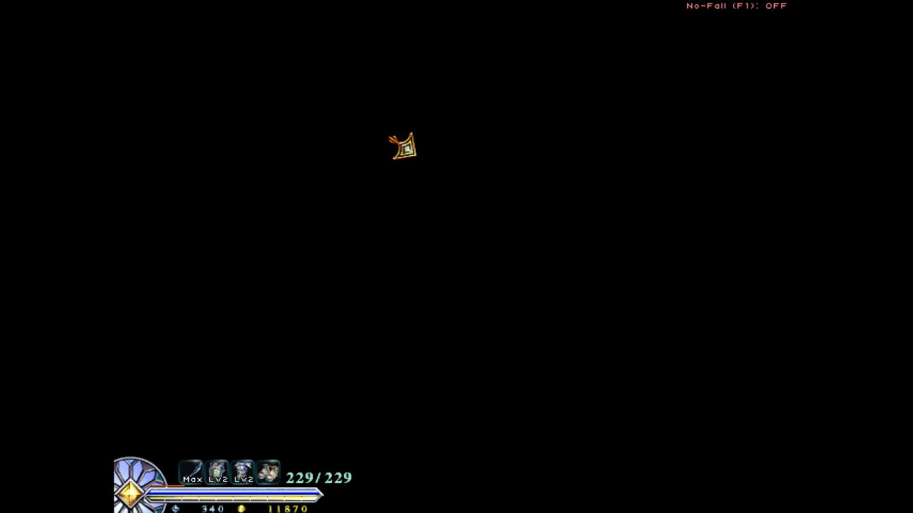
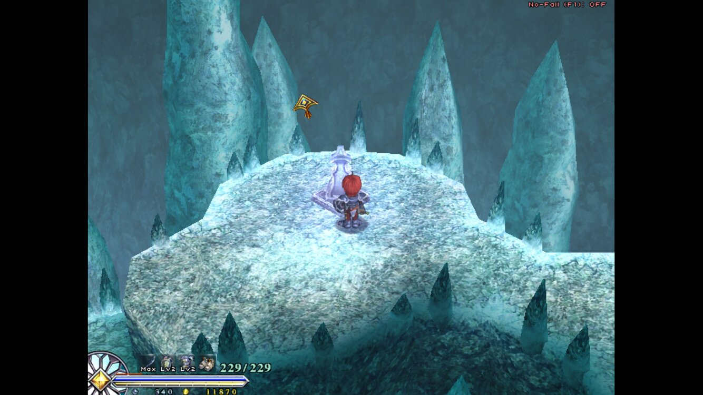

# Changelog

[README](README.md) · [Games](GAMES.md) · **Changelog** · [Fixes](FIXES.md) · [License](LICENSE)

Newest first. Each build is on the [Releases](../../releases) page; from fix43 on, the app's **Updates** page
offers new ones by itself.

## fix51: leaving a Retro game closes its emulator

Leaving a Retro game with Home used to keep the emulator open in the background, with the game paused. It held
its memory while Steam games ran (memory is tight on the RP4 Pro with a Steam game up), and when DroidDeck itself
closed, for an update for example, Android brought that game back to the front.

DroidDeck now remembers which emulator a Retro game started in and closes it 5 seconds after you're back on any
DroidDeck screen, the Steam screen included. The emulator has written its save by then; if you go back into it
within those 5 seconds, it stays open. Tested with My Boy!.

One thing it can't do: Android keeps the emulator's entry in its recent-apps list, and can reopen it when DroidDeck
itself closes. One app can't remove another app's entry, so if a game ever pops up after an update, swipe the
emulator away in Android's recent apps.

## fix50: fast cores first for every game

Older PC games lock their main thread to Windows "CPU 0". On a PC that is a fast core; on the RP4 Pro's
Dimensity 1100 it is one of the four slow Cortex-A55 cores. That is what held Tales of Symphonia's battles at
15 fps until fix49 gave it its own setting.

fix50 does it for every game: just before a game starts, DroidDeck reads each core's top speed and has Wine number
them fastest first (`WINE_CPU_TOPOLOGY`, here `8:4,5,6,7,0,1,2,3`), so "CPU 0" is a fast core on any chip layout.
Games that don't lock themselves to a core run exactly as before. Of the six games checked (Symphonia, Ys Origin,
Oath, Ark, Ys I, TMNT), only Symphonia locks a core; its fix49 entry was written for this chip only, so it is
gone, and DroidDeck takes it back by itself on first start.

It stays off when a game has its own `WINE_CPU_TOPOLOGY`, when you choose **Game cores**, when all cores run at the
same speed or core 0 is already a fast one, or with `BL_FAST_CORES_FIRST=0`.

## fix49: Tales of Symphonia at full speed, on v0.5.4.2

This build also carries fix46 to fix48, which were never released on their own.

- **Tales of Symphonia battles: 15 fps -> 30 (the game's cap), 60 on screen with LSFG 2x.** The game locks its
  main thread to "CPU 0". On a PC that is a fast core; on the RP4 Pro it is one of the four slow Cortex-A55 cores,
  so the whole game ran on the weakest core while the fast A78s sat idle. DroidDeck now tells Wine to number the
  cores fast-first for this game (`WINE_CPU_TOPOLOGY`, from its known-games table), so "CPU 0" is an A78. It also
  loads faster. Best setting: Retroid **Performance** mode (the middle one) with **LSFG 2x**: about 60 fps on
  screen with the GPU at half load. On **Standard** the fast cores slow down too far and battles drop to about 12.
- **Rebased on ASEbrahim's DroidDeck Mali v0.5.4.2** (fix46), with all the RP4 Pro fixes and the Retro tab on top.
- **Anti-aliasing switch for Ys Origin** (fix47): a card on the game's Launch settings, 4x or Off. Off takes the
  Search Party's Base from 45 to 77 fps; 4x has smoother edges. It changes only that one setting in the game's
  own settings file.
- **Ys Origin: the real cause of the white rooms** (fix48): like Oath, it was Microsoft's own `d3dx9` under FEX.
  DroidDeck now switches Ys Origin to Wine's built-in `d3dx9` by itself, and effects that had been hidden are back:
  the brazier fire and the statue glow.
- **The Frame limit now caps DXVK games too** (fix48). Steam -> Settings -> Display -> Frame limit used to cap only
  the screen, so a game without vsync kept rendering past it. At 60 it now holds exactly 60.0 fps, and in Ys Origin
  the GPU drops to its lowest clock (about 47 % busy), which saves battery.

## fix45: Ys: The Oath in Felghana draws its world

In the DirectX 9 version, a loaded save showed only the HUD on black. The game was drawing the world, but every
world matrix came out as NaN: they come from Microsoft's own `d3dx9` library, which gets them wrong under FEX
(the x86 emulator). Wine's built-in `d3dx9` gets them right, so DroidDeck now switches Oath to it by itself (its
known-games table). Icebound Cave runs at 69 fps. Details in [FIXES.md](FIXES.md).

| Before: only the HUD on black | After fix45: 69 fps |
|---|---|
|  |  |

## fix44: Tales of Symphonia starts

It used to close at once and drop back to the Steam page. The game asks for 2x anti-aliasing (MSAA), and this
GPU only does 1x and 4x. DXVK tells the game 2x is there, then can't make it, so the game quits. A new bridge
erratum, `msaa2_as_4`, offers 2x and quietly makes it with 4 samples, so any game that asks for 2x is covered.
On fix43 it shows up in the app's **Updates** page.

## fix43: updates from this repository

The app's **Updates** page now follows this repository's releases. Before, it offered the official MaliBridge
APKs, which won't install over this build (another signing key) and leave out these fixes. On fix42 or older,
install fix43 by hand once; after that, new builds show up in Updates.

## fix42: v0.5.4.1 from source, and the Retro tab

fix42 is built from source on DroidDeck Mali v0.5.4.1, so it replaces the whole app. It's signed with the same
personal debug key as fix14, so it installs over it.

- **Rebased on DroidDeck Mali v0.5.4.1.** The bridge fixes now sit on top of ASEbrahim's v0.5.4.1 release. Steam,
  Ys I, Ys Origin's rooms and sleep/resume have been checked on it.
- **A Retro tab.** A front end for your emulators, built into DroidDeck so Steam games and retro games live in
  one place (inspired by Daijishō, see [Credits](README.md#credits)). Retro in the side bar opens a start screen
  like Steam's: covers from your own library drift past, with **Play Retro Games** and a Settings sheet. Play
  opens retro mode over the whole screen, with two tabs:
  - **Library:** a card per system. L1/R1, or D-pad down to the systems strip and then left/right, flips
    between them. A system's games open as a list (the selected game's screenshot or cover beside the titles;
    Ⓧ switches between the two) or as a box-art grid. B steps back one level at a time.
  - **Settings:** each system's emulator in a pop-up list (RetroArch cores, My Boy!, PPSSPP, Dolphin, DraStic
    and so on), your ROM folders, the default view (list or grid) and list picture, and wallpaper packs.

  It picks up your existing `Roms` folders on internal storage and the SD card. Covers, screenshots and game
  info (genre, year, developer) come from libretro's databases, and PSP, GameCube and cartridge games are named
  from the disc or a checksum rather than the file name. It has favorites (★) and recently played. Every game
  starts fresh: an emulator left running in the background is closed first, so a new game never comes up as
  the old one or a black screen, and Home from a game brings you back to retro mode where you were. See
  [Games and BIOS files](README.md#games-and-bios-files).
- **An opt-in cached memory switch** for games that write to GPU memory one byte at a time (see
  [Device tips](README.md#other-tips)). It's off unless you turn it on for a game.

## fix14 and earlier

The stock v0.5.4 APK with three libraries replaced: Steam starts, SD-card games run, Ys Origin's white rooms
are gone, "press Play twice" no longer crashes, and LSFG works on the Vulkan 1.1 driver (fix14). Each is a row
in [FIXES.md](FIXES.md); [`docs/PROGRESS-LOG.md`](docs/PROGRESS-LOG.md) has the day-by-day log.
